# K8s 云管平台（k8s-cloud-platform）

面向**多集群 Kubernetes** 的 Web 管理平台。平台管理员负责纳管集群、网络与组织；租户在自己的命名空间里
做应用交付、资源管理、中间件与观测。仓库是 **Maven 多模块后端 + Vue 3 单页前端**，四个可部署服务、三个库模块。

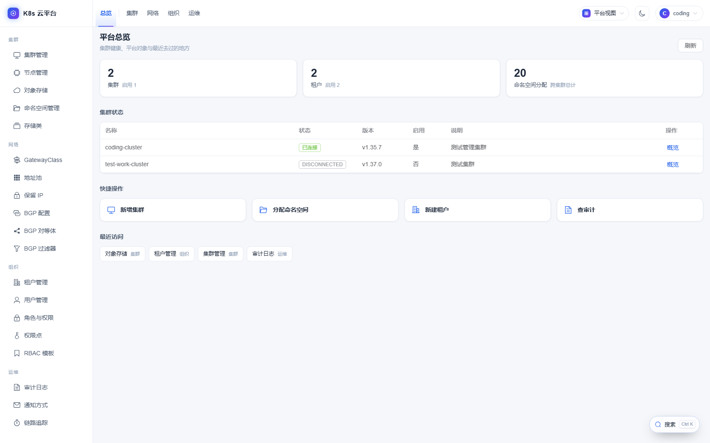

> 平台自己也是"有状态"的：数据库迁移要**手工重放**、两个 AES 主密钥必须与库中密文一致、
> 认证服务必须先于其它服务启动。这几条都在 [§7 注意事项](#7-必须知道的约定与注意事项) 里，部署前请先读。

### 产品特点

- **两个视图，各司其职**：平台视图管集群、网络、组织与运维；租户视图只看自己的命名空间，做应用、资源、存储和观测。
- **多租户隔离分四层**：权限表、端点边界、资源边界、K8s RBAC 层层把关，默认拒绝；权限行漏配时应用直接拒启。
- **应用交付一条线**：服务 + 依赖 + 不可变发布（可回滚），Tekton 流水线构建，内置 Harbor 组件与镜像来源纳管。
- **中间件开箱即用**：Redis、MySQL、PostgreSQL、Kafka、RabbitMQ、Elasticsearch、Nacos、Milvus 八款，支持创建实例、改规格、查连接方式。
- **集群组件一键安装**：仓库内置 Helm chart，Istio、Calico、Prometheus、Thanos、Tempo、SeaweedFS 等可直接从页面安装。
- **观测闭环**：指标、告警、日志、链路集中在同一套界面，日志可一键跳转到对应链路，还有基于 Istio 指标的网格拓扑。
- **网络能力到位**：Gateway API 七类对象、Istio ambient、Calico 地址池与 BGP 都有可视化管理。
- **操作可追溯**：写操作和被拒绝的请求都进审计日志；权限点可按 URL 反查覆盖关系，排障直接定位到权限码。
- **深浅双主题**：顶栏一键切换，本文截图均为浅色模式。

---

## 1. 架构总览

```
浏览器（同源）
   │
   ▼
platform-web（nginx）
   ├── /api/**  ──▶  platform-api（:8081）── HTTP ──▶ k8s-server（:8080）── fabric8 ──▶ 被纳管的 K8s 集群
   └── /auth/** ──▶  platform-auth（:9527/auth）── 签发 JWT、暴露 JWKS

platform-api / k8s-server 用 JWKS 校验 JWT；MySQL / Redis 由三个后端服务按需访问。
```

| 模块 | 类型 | 端口 | 职责 |
|---|---|---|---|
| [`platform-web`](platform-web) | 部署单元 | 80（dev 5173） | Vue 3 SPA + nginx 反向代理、TLS 终止（可选） |
| [`platform-api`](platform-api) | 部署单元 | 8081 | 管理面 BFF：业务规则、权限判定、数据库、聚合与缓存 |
| [`k8s-server`](k8s-server) | 部署单元 | 8080 | K8s **执行面/适配器**：零业务逻辑，唯一直接访问 K8s API 的进程 |
| [`platform-auth`](platform-auth) | 部署单元 | 9527（`/auth`） | 统一认证与授权服务器：登录、OAuth2/OIDC、令牌签发、会话续期 |
| [`k8s-core`](k8s-core) | 库 | — | fabric8 封装：operations / converter / factory，只被 k8s-server 依赖 |
| [`platform-common`](platform-common) | 库 | — | 公共组件：JWT 编解码、响应码、通用模型与工具 |
| [`platform-data`](platform-data) | 库 | — | 持久层：MyBatis Mapper、实体、**SQL 迁移脚本** |

**请求链路**：浏览器 → nginx（`/api` 去前缀）→ platform-api（鉴权 + 业务）→ HTTP → k8s-server（边界判定 + K8s 调用）。
platform-api **不依赖 fabric8**，也不直接连集群。

---

## 2. 技术栈与依赖

### 2.1 后端

| 组件 | 版本 | 说明 |
|---|---|---|
| JDK | **21** | 全部模块；`-parameters` 编入字节码 |
| Spring Boot | **4.1.2** | 以 BOM import，不是 `spring-boot-starter-parent` |
| fabric8 Kubernetes Client | **7.9.0** | k8s-core 使用；含同版本 `tekton-client` |
| MyBatis Spring Boot Starter | 4.0.1 | `mapper/**/*.xml`，下划线转驼峰 |
| PageHelper | 4.1.0 | 分页 |
| Spring Security | Boot BOM | OAuth2 授权服务器（auth）/ 资源服务器（api、k8s-server） |
| Nimbus JOSE+JWT | 10.4 | JWS/JWE 编解码 |
| Google Tink | 1.21.0 | 加密工具 |
| Knife4j | 4.6.0 | OpenAPI 文档（三个服务都开） |
| Jackson | 3.x（`tools.jackson`） | Boot BOM 管理；k8s-server 同时存在 Jackson 2（fabric8 / MinIO 带入） |
| MinIO Java SDK | 8.5.17 | S3 协议客户端（SeaweedFS 桶/对象操作） |
| Caffeine | 3.2.3 | 本地缓存（auth） |
| Spring Session Redis | Boot BOM | 会话放 Redis，多实例/重启不丢 |
| Spring WebSocket | Boot BOM | Pod exec / 日志 follow 的 WS 升级 |
| Spring Data Elasticsearch | Boot BOM | 日志查询中心数据源 |
| JavaMail | Boot BOM | 告警邮件通知 |

### 2.2 前端（`platform-web`）

| 组件 | 版本 | 用途 |
|---|---|---|
| Vue / Vue Router | 3.5 / 4.5 | SPA、history 路由 |
| Vite | 8.1 | 构建与 dev server（`/api`、`/auth` 代理） |
| TypeScript / vue-tsc | 6.0 / 3.3 | 类型检查（`npm run build` 会先跑） |
| Element Plus | 2.9 | UI 组件库 |
| Tailwind CSS | 3.4 | 原子化样式 |
| ECharts | 5.6 | 指标曲线、拓扑 |
| Vue Flow | 1.48 | 应用拓扑、流水线画布 |
| xterm.js | 6 | 容器终端 |
| highlight.js | 11 | YAML 展示与高亮 |
| axios | 1.7 | HTTP 客户端 |

**Node 版本**：`^22.18.0 || >=24.12.0`（见 `package.json` 的 `engines`）。

### 2.3 外部基础设施

| 依赖 | 必需性 | 用途 |
|---|---|---|
| MySQL | 必需 | 用户/租户/角色/权限/集群注册/分配表/流水线台账等 |
| Redis | 必需 | auth 的会话；api 的跨实例 TTL 缓存（`platform:cache:*`） |
| Kubernetes 集群 | 必需 | 被纳管对象；kubeconfig 加密存库 |
| Prometheus / Thanos | 可选 | 集群概览、指标曲线、告警规则 |
| Alertmanager | 可选 | 告警事件推送到 `/alert/webhook` |
| Elasticsearch | 可选 | 日志查询中心 |
| Tempo + OTel Collector | 可选 | 链路追踪 |
| Harbor | 可选 | 镜像仓库组件 + 平台镜像来源改写目标 |
| SeaweedFS | 可选 | 对象存储组件（桶、凭据、对象浏览） |

### 2.4 仓库内置 Helm chart

`k8s-server/src/main/resources/charts/` 下是平台"集群组件安装"和"中间件商店"直接使用的 chart：

- **components**：cert-manager、gateway-api、harbor、istio（base/cni/istiod/ztunnel/gateway）、metrics-server、
  otel-operator、prometheus-operator、projectcalico-crds、tigera-operator、seaweedfs、tekton-operator、tempo、thanos
- **middleware**：redis、mysql、postgresql、kafka、rabbitmq、elasticsearch、nacos、milvus
- **app**：应用编排生成的资源模板

各 chart 的约定与踩坑写在 `charts/components/<chart>/README.md`（**组件级 README**，版本目录只记录该版本事实）。

---

## 3. 功能一览

按前端导航的两个视图（平台视图 / 租户视图）组织；菜单由**路由 meta 派生**，不是手写清单。

| 域 | 主要能力 |
|---|---|
| **集群** | 集群注册与探活、节点管理（cordon/驱逐/详情）、集群概览（资源总量、per-ns 明细、健康摘要）、命名空间管理（配额/限制范围/描述/受保护 ns）、存储类 |
| **网络** | Service、Gateway API 七类对象（GatewayClass / Gateway / HTTP·GRPC·TCP·TLS·UDPRoute）、路由五合一页面、网格拓扑、Calico（IPPool / IPReservation / BGP 配置·对等体·过滤器 / IPAM 浏览）、静态 IP 绑定 |
| **应用** | 应用发布（服务/后台进程 + 中间件/外部依赖，变量引用、待发布改动、发布与回滚、只读拓扑）、中间件商店与实例（8 款 + 用户管理）、流水线（Tekton：编辑、运行、日志、重试）、Git 凭据、镜像仓库与镜像来源纳管 |
| **资源** | 工作负载（Deployment/StatefulSet/DaemonSet/Job 等，回滚/副本/重启/历史）、Pod（日志、Exec 终端）、HPA、ConfigMap、Secret、PVC、持久卷 |
| **存储** | PVC / PV、对象存储（SeaweedFS 桶、凭据、对象读写、桶配额、匿名读） |
| **观测** | 告警（PrometheusRule、告警列表、通知渠道）、ServiceMonitor / PodMonitor、日志查询（ES）、链路追踪（Tempo） |
| **组织** | 租户管理、用户管理、角色与权限、权限点、RBAC 模板（下发到集群生成 RoleBinding/ClusterRole） |
| **运维** | 审计日志、通知方式、个人中心 |

平台域与租户域使用**两套权限码**（`platform:*` / `tenant:*`）；管理员可持两族，租户角色只能持 `tenant:*`。

### 3.1 界面预览

截图来自测试环境，内网 IP 已打码。

#### 平台视图

<table>
  <tr>
    <td width="50%">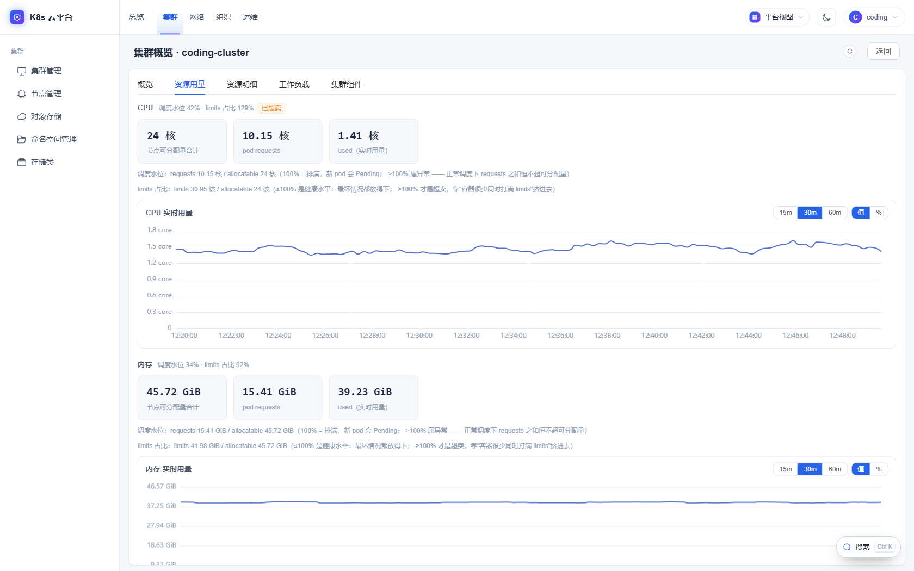<br><b>集群概览</b>：可分配量、requests、实时用量对照，超卖一眼可见</td>
    <td width="50%">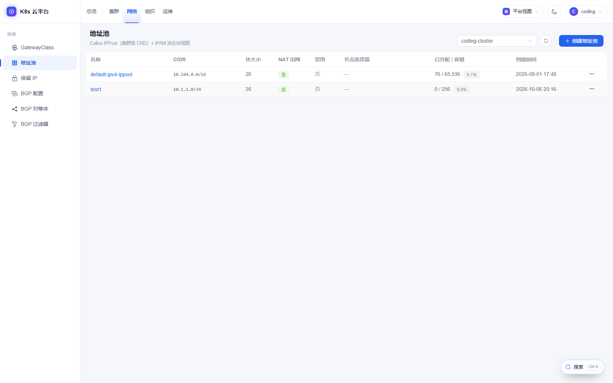<br><b>Calico 地址池</b>：CIDR、块大小、NAT 与 IPAM 分配水位</td>
  </tr>
  <tr>
    <td>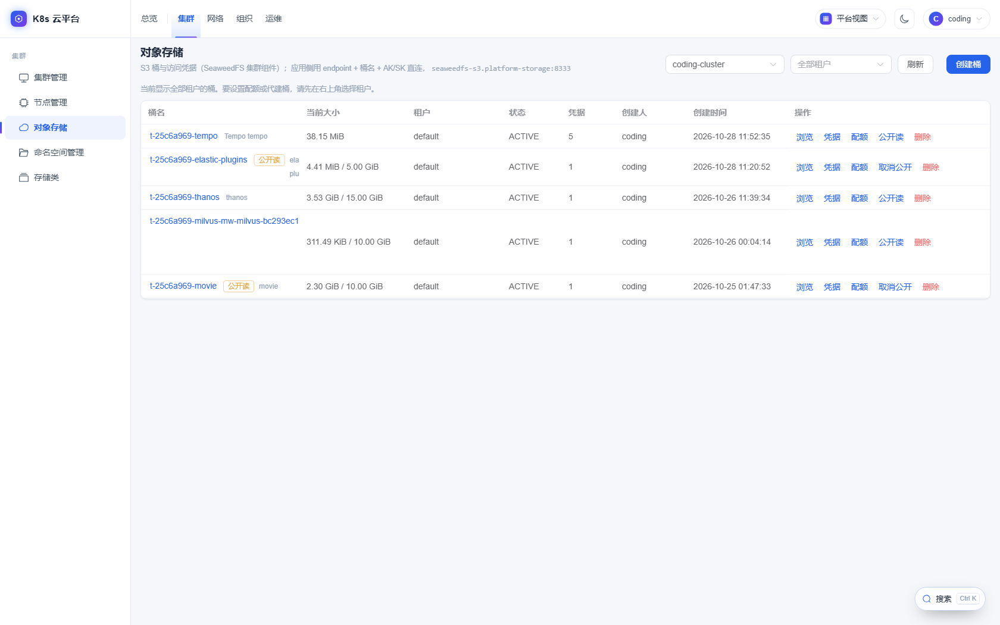<br><b>对象存储</b>：SeaweedFS 桶、用量配额、凭据与公开读</td>
    <td>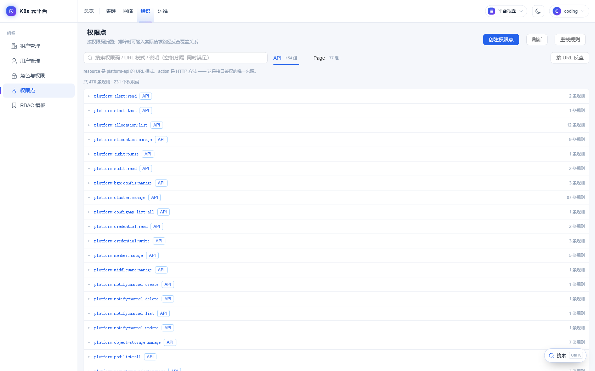<br><b>权限点</b>：按权限码分组折叠，支持关键词搜索和 URL 反查</td>
  </tr>
  <tr>
    <td>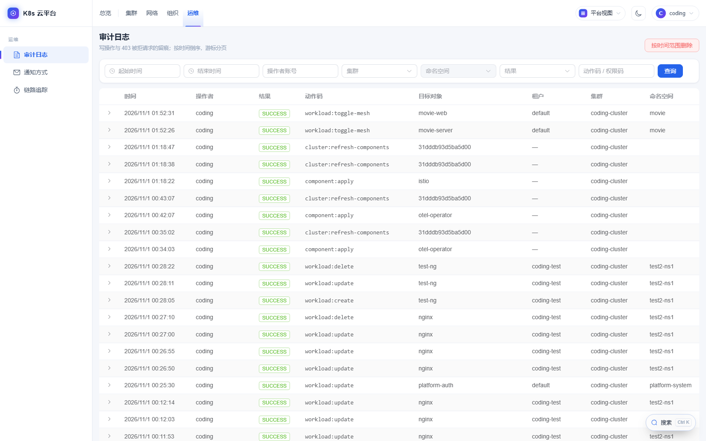<br><b>审计日志</b>：记录写操作与 403 拒绝，可按人、集群、命名空间筛选</td>
    <td></td>
  </tr>
</table>

#### 租户视图

<table>
  <tr>
    <td width="50%">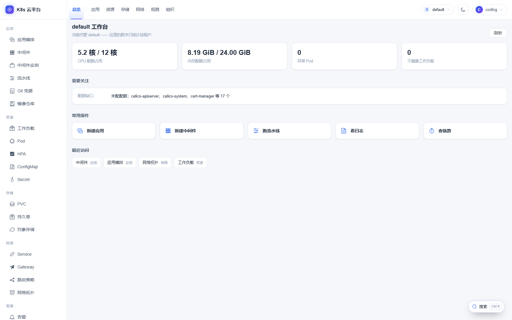<br><b>租户工作台</b>：配额占用、异常 Pod、需要关注的事项与常用入口</td>
    <td width="50%">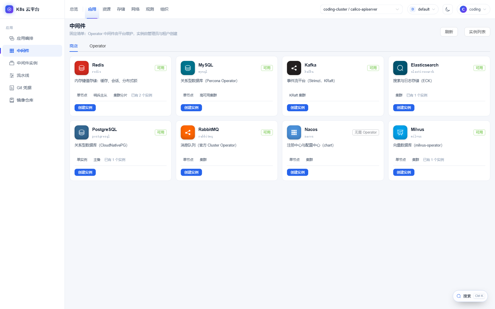<br><b>中间件商店</b>：八款中间件，按单节点、集群等形态创建实例</td>
  </tr>
  <tr>
    <td>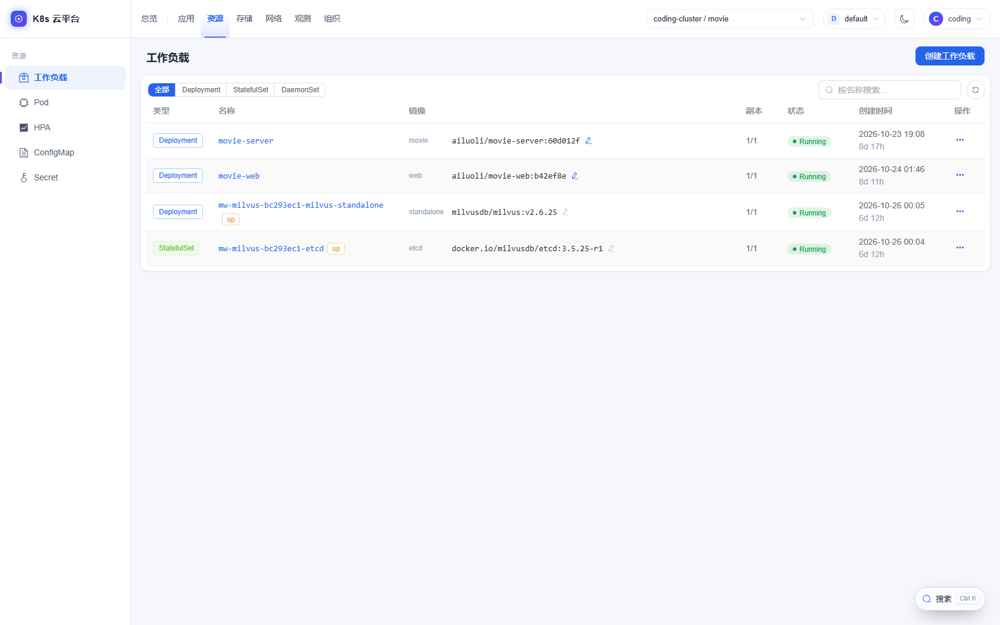<br><b>工作负载</b>：按类型筛选，副本、状态、镜像集中展示，受 Operator 管理的对象带 <code>op</code> 标记</td>
    <td>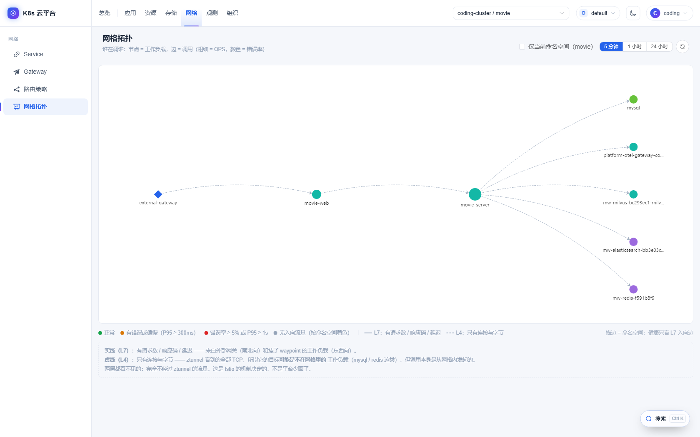<br><b>网格拓扑</b>：节点是工作负载，边是调用，线型区分 L7 / L4</td>
  </tr>
  <tr>
    <td>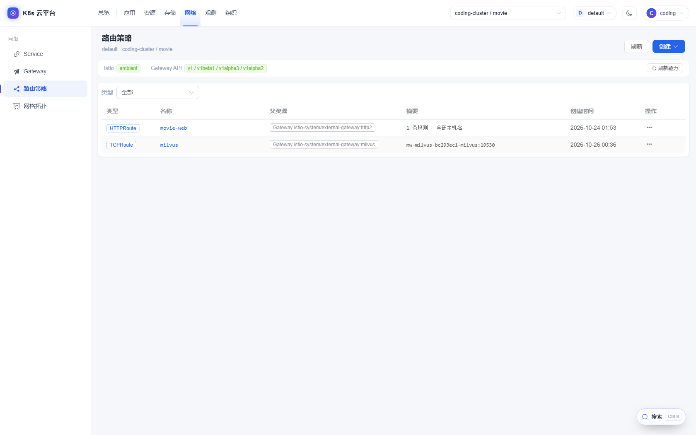<br><b>路由策略</b>：HTTP、TCP 等路由集中管理，并探测集群的 Istio 与 Gateway API 能力</td>
    <td>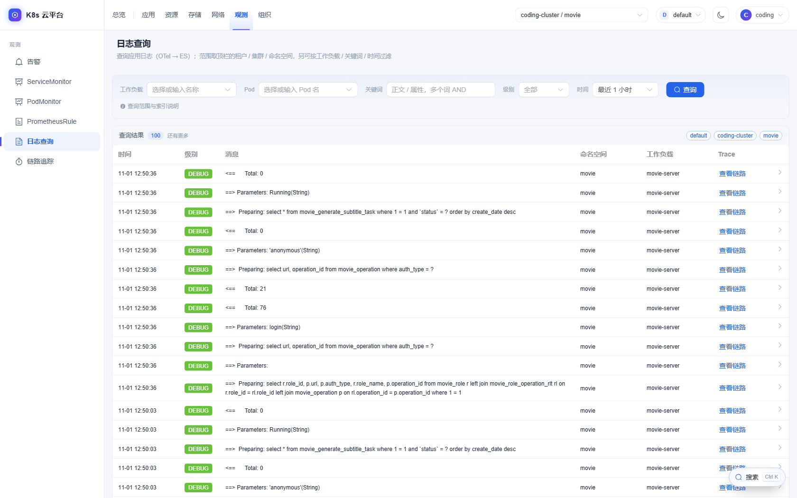<br><b>日志查询</b>：按工作负载、Pod、关键词、级别过滤，可跳转到对应链路</td>
  </tr>
  <tr>
    <td>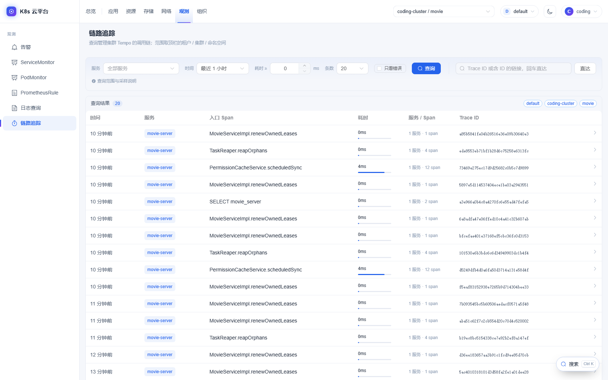<br><b>链路追踪</b>：基于 Tempo 查询调用链，范围按租户收窄</td>
    <td></td>
  </tr>
</table>

---

## 4. 快速开始

### 4.1 前置

- JDK 21、Maven 3.9+（本机实测 3.10）
- Node `^22.18 || >=24.12`、npm
- MySQL（库 `k8s_cloud_platform`）、Redis
- 一个可访问的 K8s 集群及 kubeconfig（首次纳管时在页面里导入）

### 4.2 数据库迁移（**必须先做**）

本仓库**没有 Flyway / Liquibase**。迁移脚本是 `platform-data/src/main/resources/db/migration/*.sql`，
按文件名顺序**手工重放**：

```bash
ls platform-data/src/main/resources/db/migration   # V2026_09_24_1__... → 按序执行
```

首次建库可以直接导入根目录的全量 dump `k8s_cloud_platform.sql`（它停留在较早的基线，**之后的新迁移仍要补跑**）。
规则：**先重放本次新增的 SQL，再启动新构建** —— 新代码里有过 fail-closed 的启动期交叉校验，缺表/缺权限行会直接拒启。

### 4.3 编译与测试

```bash
# 全量构建 + 测试
mvn -B clean package

# 只构建某个服务（含它依赖的库模块）
mvn -B -pl platform-api -am -DskipTests package
```

> 父 POM 用的是 BOM import，所以 `spring-boot-maven-plugin` 的 `repackage` 已在父 POM 里显式绑定 ——
> 产物是可执行的 fat jar；没有这段绑定会得到"没有 Main-Class"的瘦 jar。

### 4.4 本地启动顺序

1. MySQL、Redis
2. `platform-auth`（9527）—— **必须最先起**：其它服务首次校验令牌就要拉 JWKS，auth 没起来会全站 401
3. `k8s-server`（8080）、`platform-api`（8081）
4. `platform-web`

```bash
java -jar platform-auth/target/platform-auth-1.0.0.jar
java -jar k8s-server/target/k8s-server-1.0.0.jar
java -jar platform-api/target/platform-api-1.0.0.jar
```

前端开发（Vite 代理 `/api` → 8081、`/auth` → `OAUTH_UPSTREAM`）：

```bash
cd platform-web && npm ci && npm run dev
```

生产构建：

```bash
cd platform-web && VITE_OAUTH_ISSUER=/auth VITE_OAUTH_CLIENT_ID=platform-web-client \
  VITE_OAUTH_REDIRECT_URI=http://<你的域名>/callback npm ci && npm run build-only
```

### 4.5 镜像构建（**两步，Dockerfile 不编译**）

```bash
# 1) 先在仓库根编译
mvn -B -pl platform-api -am -DskipTests package
# 2) 再打包镜像，构建上下文是模块目录
docker build -f platform-api/Dockerfile -t k8s-cloud-platform/platform-api:latest platform-api
```

`k8s-server` 镜像额外内置 **Helm 4.2.0** 与 **kubectl**（组件安装用），并复制内置 chart 到 `/app/charts`。
四个服务的 Dockerfile 头部都写了该服务的运行参数与必填环境变量，部署前值得逐个读一遍。

---

## 5. 配置（环境变量）

默认值写在各自的 `application.yaml` / `application.yml` 里，**多数是研发环境地址**（192.168.x），
容器部署时必须覆盖为真实地址。常用项：

| 变量 | 服务 | 说明 |
|---|---|---|
| `MYSQL_URL` / `MYSQL_USERNAME` / `MYSQL_PASSWORD` | api、auth、k8s-server | 同一个库 |
| `REDIS_HOST` / `REDIS_PORT` / `REDIS_PASSWORD` | api、auth | auth 会话固定用 database 1；api 缓存用 `REDIS_CACHE_DATABASE`（默认同为 1），同库不同键前缀（`spring:session:*` vs `platform:cache:*`） |
| `OAUTH2_SERVER` | api、k8s-server | JWKS 地址，**必须带 `/auth`**，默认 `http://…:9527/auth/oauth2/jwks` |
| `K8S_SERVER_URL` | api | k8s-server 地址，默认 `http://127.0.0.1:8080` |
| `KUBECONFIG_AES_KEY` | api、k8s-server | 解密集群 kubeconfig；**与库中密文绑定**，不可随意更换 |
| `CREDENTIAL_AES_KEY` | api | 凭据库主密钥；**留空拒启**，与库中密文绑定 |
| `ALERT_WEBHOOK_TOKEN` | api | Alertmanager webhook 共享密钥；**留空拒启** |
| `THANOS_QUERY_URL` | api | 指标曲线数据源 |
| `PLATFORM_ES_URL` / `PLATFORM_ES_USERNAME` / `PLATFORM_ES_PASSWORD` | api | 日志查询（留空 = 页面提示未配置） |
| `OUTBOUND_PROXY_SERVER` / `_PORT` / `_TARGETS` | api | **白名单**出站代理：只有列出的目标走代理，内网一律直连 |
| `PIPELINE_LOG_MAX_BYTES` | api、k8s-server | 单步日志上限，**两边必须一致** |
| `PIPELINE_ARCHIVE_ENABLED` / `PIPELINE_RUN_TIMEOUT` / `PIPELINE_TIMEOUT_CHECK` | k8s-server | CI 归档与超时对账 |
| `HARBOR_DEFAULT_HOST` / `HARBOR_TLS_CERT_FILE` / `HARBOR_TLS_KEY_FILE` | api | Harbor 安装表单默认值 |
| `VITE_OAUTH_ISSUER` / `VITE_OAUTH_CLIENT_ID` / `VITE_OAUTH_REDIRECT_URI` | platform-web（**构建期**） | 改域名/端口要**重新构建**，不是重启容器 |
| `OAUTH_UPSTREAM` | platform-web dev server | 真实 auth 的 origin（不带 `/auth`） |

### 5.1 纳管集群的集群侧前提

有些能力不只看平台代码，还取决于集群里的配置（Tekton feature flag、配额下的默认容器资源、
可动态供应的 StorageClass / RWX 存储、Istio 指标采集、Alertmanager 指向平台等）。
完整清单与可粘贴的命令见 [docs/development/cluster-prerequisites.md](docs/development/cluster-prerequisites.md)；
这部分**不在仓库里**，换集群/重建集群要重做。

---

## 6. 目录结构

```
k8s-cloud-platform/
├── k8s-core/            fabric8 operations / converter / factory（仅 k8s-server 依赖）
├── k8s-server/          K8s 执行面；内置 charts 与 Helm/kubectl 运行镜像
├── platform-auth/       OAuth2/OIDC 授权服务器（/auth）
├── platform-api/        管理面 BFF：业务、权限、DB、聚合缓存
├── platform-common/     JWT、响应码、通用模型
├── platform-data/       MyBatis Mapper/实体 + resources/db/migration（**手工重放**）
├── platform-web/        Vue 3 SPA；nginx.conf / nginx-https.conf
├── docs/                设计与运维文档（见 §8）；images/ 放 README 截图
├── scripts/             harbor-replication.py（把组件镜像同步进平台 Harbor）
└── k8s_cloud_platform.sql   早期全量 DB dump（基线，不含后续迁移）
```

被 `.gitignore` 排除的本地内容：`cert/`（部署证书）、`.claude/`、`.superpowers/`、各模块 `target/`。

---

## 7. 必须知道的约定与注意事项

### 7.1 没有数据库迁移工具

- 脚本在 `platform-data/src/main/resources/db/migration`，命名 `V<日期>_<序号>__说明.sql`。
- 启动日志里**永远不会有** "Migrating schema" —— 那是正常的，不是配置漏了。
- 上线流程固定为：**按序重放新增 SQL → 再起新构建**。代码与迁移必须同批，迁移先于构建。
- 迁移里写的权限行是 fail-closed 校验的输入（见下条）。

### 7.2 权限是 fail-closed 的，权限行必须进迁移

- API 域按 `(HTTP 方法, 路径)` 映射到权限码，默认拒绝；启动期 `PermissionCrossCheckRunner` 做交叉校验，
  **漏配权限行 = 应用拒绝启动**。
- 权限码**不在 token 里**（2026-10-09 起）：platform-api 在请求期现算权限闭包（30s TTL 缓存），
  因此改角色**即时生效**，陈旧上界是一个缓存 TTL。
- 回滚开关：`platform.jwt.permissions-in-token=true`。
- 可分配权限集合由后端 `/role/permission/assignable` 下发，**前端不要自己按 `platform:` / `tenant:` 前缀过滤**。

### 7.3 分层是硬规则

```
HTTP → Controller（只做绑定与包装）→ Service（业务/编排/降级）→ Client（传输）→ k8s-server
```

- controller **禁止**注入 `K8s*Client` / `K8sServerGateway`，**禁止**出现 k8s-server 路径字符串，**禁止**业务判断。
- 每个资源一个 Service，即使当前是纯透传。
- **k8s-server 零业务逻辑**（用户钦定）：它只回答"能不能碰这个端点""能碰哪些 namespace""用谁的凭据"。
- **同类资源不抽公共基类**：宁可逐资源各写一份（2026-10-09 明确否决抽象提案）。
- 完整判据与自查清单：[docs/development/backend-layering.md](docs/development/backend-layering.md)。

### 7.4 安全边界分四层，`K8s*Client` 不是边界

| 层 | 实现 | 判什么 |
|---|---|---|
| ① platform-api 权限表 | 权限码 ANY-of，默认拒绝 | 细粒度"能不能做这件事" |
| ② k8s-server 端点边界 | `AccessBoundary`（`PLATFORM` / `TENANT` / `UPSTREAM`）+ `PLATFORM_SCOPE` | 哪个端点是平台侧 |
| ③ k8s-server 资源边界 | `ResourceAccessResolver` + 分配表三元组 | 能碰哪些 namespace、用谁的凭据 |
| ④ K8s RBAC | 租户 SA / admin kubeconfig | 集群侧第二道闸 |

新增 controller 必须继承基类或实现 `AccessBoundaryAware`，**读不到声明会被 fail-closed 拒绝**（连平台管理员一起 403）。
分配表的授权范围完全由 `platform_tenant_namespace` 决定 —— 判断"算不算越权"前先查表，别只看代码。

### 7.5 OAuth 必须同源

- `platform-auth` 配了 `server.servlet.context-path=/auth`，所有端点都在 `/auth/**`；
  反代只需一条 `/auth/` 前缀，且 **proxy_pass 不能带 URI**（会剥掉前缀）。
- platform-api / k8s-server 的 `OAUTH2_SERVER` **必须带 `/auth`**，否则拉不到 JWKS → 全站 401。
- 前端 `VITE_OAUTH_ISSUER` 只写上下文路径 `/auth`；`redirect_uri` 必须与 auth 库中注册的一字不差。
- 续期/keepalive/登出依赖 `SameSite=Lax` 的会话 Cookie：`localhost` 与 `127.0.0.1` 也算跨站。
- 局域网 **http 是非安全上下文**：`crypto.subtle`、`navigator.clipboard` 不存在，代码里已有纯 JS / execCommand 兜底，
  新代码不要假设它们可用。

### 7.6 写 K8s 对象统一走 Server-Side Apply

- fabric8 7.9.0 的 `create` / `update` 统一走 SSA，`fieldManager=platform-system`、`force`。
- **atomic list 字段**（如 Gateway 的 `listeners`、某些 CRD 的列表）SSA 不会合并，必须建模或
  "读线上对象 → 整体覆写"（fetch-overlay），否则会丢字段。
- 部分字段（如 Deployment 回滚用的 `pod-template-hash`）必须在写入前剥掉。

### 7.7 数量单位

K8s `Quantity` 在 DTO 层统一为 **`BigDecimal` 基础单位**：CPU = 核数，内存/存储 = 字节。
前端负责换算与展示；新增接口沿用这一约定。

### 7.8 前端

- 菜单由**路由 meta**（`domain` / `icon` / `order` / `requiresPerm`）派生，加页面 = 在路由上补 meta，
  不要维护第二份菜单清单。同名域跨视图时必须用 `resolveNavLocation().otherFace` 换对面那份。
- 平台视图 = 管理员专属：非管理员没有该选项，bootstrap 自动落进第一个启用租户。
- 跨命名空间列表是**只读**的：行内操作按顶栏上下文的 namespace 解析，在全局视图里操作会作用到别的命名空间。
- 权限码不再写进 token（2026-10-09 起）。`data.permissions` 缺失表示"由服务端下发"，前端若用 `?? []` 兜底
  会把菜单清空 —— 必须区分"字段不存在"与"空数组"。
- Element Plus 弹窗内部节点没有 `data-v-*`，scoped `:deep()` 匹配不到 —— 用非 scoped 块 + 独有 class 前缀。

### 7.9 运行形态

- `k8s-server` 里的归档、超时对账、集群探活是**后台定时任务**，不要跑多副本。
- `CREDENTIAL_AES_KEY` / `KUBECONFIG_AES_KEY` 必须与库中已有密文一致：换值 = 所有凭据/kubeconfig 解不开。
- Redis 只是优化：读失败会退化为直查源；但它与 auth 会话**共用一个 database**，运维时不要 `FLUSHDB`。
- `ALERT_WEBHOOK_TOKEN` 不配则拒启；告警链路的集群侧配置见 [cluster-prerequisites.md](docs/development/cluster-prerequisites.md) §1.8。

---

## 8. 文档索引

| 文档 | 内容 |
|---|---|
| [docs/development/backend-layering.md](docs/development/backend-layering.md) | 后端分层、client 划分、四层安全边界、新增端点 checklist |
| [docs/development/frontend-permission-conventions.md](docs/development/frontend-permission-conventions.md) | 前端权限约定、页面码 vs API 码、视图收敛 |
| [docs/development/cluster-prerequisites.md](docs/development/cluster-prerequisites.md) | 纳管集群的集群侧前提（Tekton、配额、存储、网格指标、告警链路） |
| [docs/development/middleware-store.md](docs/development/middleware-store.md) | 中间件商店：可用条目、实例形态、指标接入 |
| [docs/development/object-storage.md](docs/development/object-storage.md) | 对象存储：桶、凭据、权限、限制 |
| [docs/development/application-release.md](docs/development/application-release.md) | 应用发布：模型、变量引用、配置文件、上线步骤、验收清单 |
| [docs/development/image-registry.md](docs/development/image-registry.md) | 镜像来源纳管与 Harbor 复制规则 |
| [docs/development/resource-protection.md](docs/development/resource-protection.md) | 受管资源保护（组件/中间件实例不可误删） |
| [k8s-server/README.md](k8s-server/README.md) | 执行面设计原则、端点边界、模块协作 |
| [platform-auth/README.md](platform-auth/README.md) | 授权服务器、令牌签发、session-renewal grant |
| [docs/CHEATSHEET.md](docs/CHEATSHEET.md) | fabric8 Kubernetes Java Client 速查 |
| [docs/superpowers/specs](docs/superpowers/specs) / [plans](docs/superpowers/plans) | 各批次设计规格与实施计划（含部署 runbook） |

---

## 9. 当前状态

- 代码以 `main` 分支为基线；多数近期批次"已实施、待部署"，部署前请对照 `docs/superpowers/plans/`
  里对应批次的迁移清单（先重放 SQL，再重建镜像）。
- 仓库**没有自动化部署脚本**：构建、迁移、重启按本文与各批次 runbook 手工执行。
